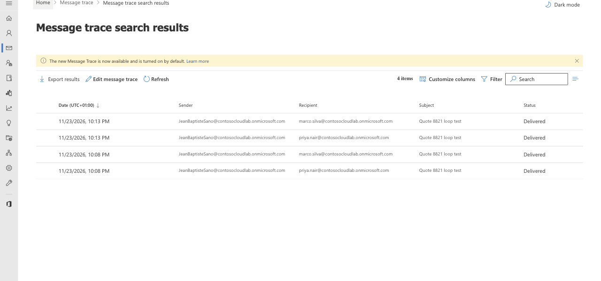

# TS-002: Two mailboxes forwarding to each other, and the bounce that never came

| | |
|---|---|
| **Level** | Intermediate |
| **Environment** | Microsoft 365 trial tenant, two licensed users, mailbox forwarding configured in both directions |
| **Access needed** | Exchange Administrator |
| **Time to resolve** | 25 minutes, most of it reading the trace rather than changing settings |

## What the user reported

"Priya and Marco are forwarding their mail to each other. That means the mail loops until Exchange gives up, doesn't it? Can you stop it before we lose something?"

Nobody attached an NDR, because there wasn't one. What the team had actually seen was a single message arriving twice: once in the mailbox it was addressed to, and once in the other person's mailbox a moment later. Somebody had read about hop-count loops and drawn the conclusion from the configuration alone.

That is the shape of this case. The dangerous setting was real, the failure everyone expected was not, and the trace is what separated the two.

## What was actually configured

Both mailboxes forwarded to the other one, and both kept a copy for themselves:

- Priya → Marco, `DeliverToMailboxAndForward = True`
- Marco → Priya, `DeliverToMailboxAndForward = True`

Neither person had set it up deliberately. One direction was left over from holiday cover, the other came from an inbox rule that survived a role change.

One detail worth knowing before you go looking: in this tenant `Get-Mailbox` returned `ForwardingAddress` as object GUIDs rather than SMTP addresses, for example `96c84851-…` and `ee161b07-…`, with `ForwardingSmtpAddress` empty. The forwarding was working; it just does not read as an address until you resolve the GUID with `Get-Recipient`. If you expect an address in that column and see a GUID, nothing is broken.

## What the message trace showed

I sent two test messages from my own mailbox to Priya, subject "Quote 8821 loop test", two minutes apart, and traced them in the Exchange admin center. All times UTC+01:00, addresses shortened to `contoso.com` here:

| Date | Sender | Recipient | Subject | Status |
|---|---|---|---|---|
| 11/23/2026, 10:13 PM | admin mailbox | marco.silva@contoso.com | Quote 8821 loop test | Delivered |
| 11/23/2026, 10:13 PM | admin mailbox | priya.nair@contoso.com | Quote 8821 loop test | Delivered |
| 11/23/2026, 10:08 PM | admin mailbox | marco.silva@contoso.com | Quote 8821 loop test | Delivered |
| 11/23/2026, 10:08 PM | admin mailbox | priya.nair@contoso.com | Quote 8821 loop test | Delivered |

Four rows, two messages. Each one reached Priya as addressed, and each one reached Marco through her forwarding. There is no second delivery back to Priya, no growth in the number of rows, no `5.4.14` NDR in the sending mailbox and nothing sitting in the queue, which a real loop would have produced within the same minute.

So the pair multiplies copies, but it does not bounce. Exchange stops the return leg itself.

## Why there is no hop-count NDR here

A hop-count loop needs a message to keep re-entering transport as a new delivery. When Marco's mailbox forwards the copy back towards Priya, that copy is the same message Priya has already received, and the transport service discards it instead of delivering it a second time. The circle closes on paper but never accumulates hops, which is why the trace has four rows instead of hundreds and why the sender never sees `5.4.14`.

The configurations that do produce the NDR are the ones where each pass looks like a new message rather than a duplicate:

- a forward out to an external domain that forwards straight back in, so every return is a fresh inbound message;
- two tenants forwarding between each other across a connector;
- a transport rule that redirects into a mailbox whose own forward points back at the rule's target, especially across an outbound connector.

I did not reproduce any of those in this tenant, and I have not written up a `5.4.14` capture I do not have.

## Where to look in the Exchange admin center

1. **Exchange admin center** → [admin.exchange.microsoft.com](https://admin.exchange.microsoft.com) → **Mail flow** → **Message trace**. Search by sender, recipient or subject. For a forwarding pair, count the rows per message and read the recipient column: one row per addressee plus one per forward is the contained case; climbing rows are a loop.
2. Same portal → **Mail flow** → **Rules**. Check transport rules that redirect or copy into either mailbox.
3. **Recipients** → **Mailboxes** → user → **Mailbox** tab → **Email forwarding**. Quickest way to see whether a forward exists and whether a copy is kept.
4. **Microsoft 365 admin center** → **Users** → **Active users** → user → **Mail** tab → **Manage email forwarding**, for the same setting from the other portal. Inbox rules are not shown there.

## Investigation with PowerShell

```powershell
Connect-ExchangeOnline -UserPrincipalName admin@contoso.onmicrosoft.com

# 1. Forwarding on both mailboxes at once
Get-Mailbox -Identity priya.nair@contoso.com, marco.silva@contoso.com |
    Format-List Name, ForwardingAddress, ForwardingSmtpAddress, DeliverToMailboxAndForward

# 2. Resolve a GUID that came back in ForwardingAddress
Get-Recipient -Identity 96c84851-0000-0000-0000-000000000000 |
    Format-List Name, PrimarySmtpAddress

# 3. Inbox rules that forward or redirect, on top of the mailbox setting
Get-InboxRule -Mailbox priya.nair@contoso.com |
    Format-List Name, Enabled, ForwardTo, RedirectTo, ForwardAsAttachmentTo
Get-InboxRule -Mailbox marco.silva@contoso.com |
    Format-List Name, Enabled, ForwardTo, RedirectTo, ForwardAsAttachmentTo

# 4. Transport rules that could copy traffic into the pair
Get-TransportRule | Format-Table Name, Priority, State, RedirectMessageTo, BlindCopyTo, StopRuleProcessing -AutoSize
```

The trace, from the same session:

```powershell
$trace = Get-MessageTrace -RecipientAddress priya.nair@contoso.com `
    -StartDate (Get-Date).AddHours(-2) -EndDate (Get-Date)
$trace | Format-Table Received, SenderAddress, RecipientAddress, Subject, Status -AutoSize

Get-MessageTraceDetail -MessageTraceId $trace[0].MessageTraceId `
    -RecipientAddress priya.nair@contoso.com |
    Format-Table Date, Event, Action, Detail -AutoSize
```

Two messages, four rows, every row `Delivered`. The detail view showed a Receive and a Deliver per copy and no further Send back to the origin mailbox.

`Get-MessageTrace` only reaches back 10 days. Older traffic needs `New-HistoricalSearch`, run from the portal, or the trace comes back empty and looks like nothing happened.

## What I changed

1. **Kept one direction, removed the other.** Marco still forwards to Priya; that was the arrangement someone actually relies on. Priya's forward was the leftover:

   ```powershell
   Set-Mailbox -Identity priya.nair@contoso.com -ForwardingAddress $null -ForwardingSmtpAddress $null -DeliverToMailboxAndForward $false
   ```

   A one-way forward cannot circle. If both directions are genuinely needed, it has to be a shared mailbox or a distribution group in the middle, not two people pointing at each other.

2. **Cleared the duplicate mechanism on the mailbox that kept forwarding.** Marco's inbox rule did the same job as his mailbox forward, which is how the pair ended up with more than one path:

   ```powershell
   Get-InboxRule -Mailbox marco.silva@contoso.com |
       Where-Object { $_.ForwardTo -or $_.RedirectTo -or $_.ForwardAsAttachmentTo }
   ```

   I disabled rather than deleted while testing, so the rule stayed available if the team wanted it back.

3. **Checked transport rules.** Neither rule in the tenant redirected into the pair, so nothing else had to change. Had a rule been copying to both mailboxes, removing the mailbox forward alone would not have fixed the duplication.

4. **Retested and counted rows.** One message in, one row out, one recipient. That is what a healthy forward looks like.

## Verification and evidence

| Check | What it proved |
|---|---|
| Message trace for the two test messages | Four rows for two messages: each delivered to the addressee and once through the forward, with no repeated cycle and no NDR |
| `Get-Mailbox` on both accounts | Forwarding existed in both directions with `DeliverToMailboxAndForward` set, and displayed as GUIDs |
| `Get-InboxRule` on both accounts | A second forwarding path existed alongside the mailbox forward on Marco's side |
| `Get-TransportRule` | No rule was redirecting or copying traffic into the pair |
| Trace after the change | One delivery per message, no copy in the second mailbox |



The capture is the trace from that run, sender column and all: four rows for two messages, every one `Delivered`, nothing cycling. It is the picture of a contained forwarding pair, which is the finding here, and it is deliberately not captioned as loop evidence. If I reproduce a genuine `5.4.14` with an external leg, that capture goes in beside this one rather than replacing it.

## Prevention notes

- When someone leaves a role, check their forwarding and their inbox rules at the same time as their licence. Most forwarding pairs I have seen were born from holiday cover that nobody removed.
- In a shared-mailbox team, one forwarder per message path. Two people forwarding to each other "so nobody misses anything" doubles storage and confuses every later investigation.
- Trust the trace over the settings page. A configuration that looks like a loop and a message that behaves like a loop are two different findings, and only one of them is a ticket.
- Keep the NDR codes in your head: 5.4.14 is a routing loop, 5.7.x is usually policy or authentication. Also keep in mind that the absence of an NDR is information, not a gap in the evidence.

## Lesson learned

I went into this expecting to write up a hop-count bounce because the configuration read like one. The trace said otherwise: Exchange already contains a two-mailbox forwarding pair, so the real problem was duplicate copies and a setting nobody owned, not a message circling the tenant. Reading the rows first, and counting them per message, took ten minutes and saved me from "fixing" a loop that was never running.
