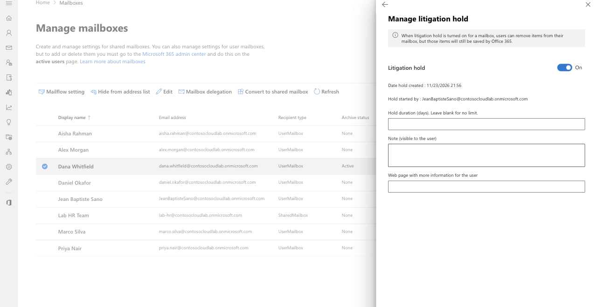
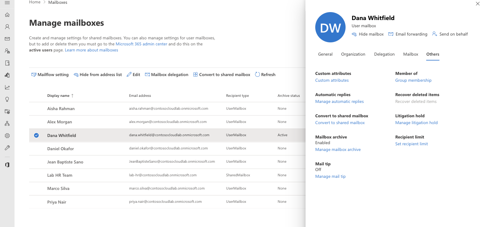

# TS-008: Litigation hold, Recoverable Items, and the quota nobody watches

| | |
|---|---|
| **Level** | Expert |
| **Environment** | Microsoft 365 trial tenant, one mailbox under litigation hold with an archive mailbox enabled |
| **Access needed** | Exchange Administrator; Legal approval is a separate requirement, not a permission |
| **Time to resolve** | Under an hour to build and read the configuration; months of mail to fill a dumpster to its default quota |

## What this case is, and what I could not show

Litigation hold keeps everything a mailbox deletes, which means the **Recoverable Items** folder grows without anyone noticing. That folder has its own quota. When it is reached, deletes stop working while the mailbox quota still looks healthy — the classic "Outlook says it is full" ticket that sends people to the wrong settings page.

I can show the configuration in this tenant: a mailbox under hold, an archive attached, and the real quota values the platform assigns. What I cannot show is the failure itself. Filling Recoverable Items to a default 100 GB takes months of genuine traffic, or a deliberate bulk run that I describe at the end of this page. Until that run happens, this case is about recognising the situation and getting the setup right before it bites, not about a screenshot of a full dumpster.

## What the tenant actually shows

- Litigation hold **On** for Dana Whitfield, created 11/23/2026 21:56 by the tenant administrator. The admin center records who started it and when, which is the part that matters in a dispute.
- **Mailbox archive: Enabled**. This is the second half of a healthy hold configuration, not an optional extra.
- `RecoverableItemsQuota` at the E5 default of **100 GB**, warning at **90 GB**, read from `Get-Mailbox`. The Exchange admin center does not display this number anywhere, which is exactly why it gets forgotten.
- Almost nothing in the mailbox. There is no folder statistics story to tell here because there is no data; that slot stays empty rather than holding a chart from another environment.

## Why the quota matters more than the mailbox size

A hold turns a delete into a move: the item leaves the folder the user sees and lands in Recoverable Items, where it stays for the life of the hold. Two consequences follow.

**The mailbox can look empty and still refuse to delete.** Mailbox quota and Recoverable Items quota are separate counters. A user at 2 GB of a 100 GB mailbox can be blocked by a full dumpster, and the error they report ("mailbox is full") points at the number that is fine.

**A hold without an archive has nowhere to put the backlog.** The archive's own Recoverable Items is where older preserved items can be moved, and the Managed Folder Assistant does that move. Without an archive, everything accumulates in the primary mailbox until the quota is hit. This tenant has the archive enabled precisely so that path exists.

The ordering trap: the fastest way to make deletes work again is to remove the hold, which is also the one action that destroys the evidence the hold exists to preserve. Space first, hold untouched, and Legal informed.

## Where to look in the Exchange admin center

1. [admin.exchange.microsoft.com](https://admin.exchange.microsoft.com) → **Recipients** → **Mailboxes** → select the user → **Others** tab. **Litigation hold** shows the state, and **Mailbox archive** shows whether there is anywhere for preserved items to move to.
2. On the same tab, **Manage litigation hold** opens the panel with the state, the creation date and the administrator who started it. That panel is what the capture below shows.
3. **Compliance portal** ([purview.microsoft.com](https://purview.microsoft.com)) → **eDiscovery** → **Cases**, to see which case owns the hold. Check here before changing anything: the hold may belong to a matter you do not own.
4. Nothing in the admin center shows Recoverable Items size or quota. Those two numbers only exist in PowerShell, which is the point of the next section.

## Investigation

```powershell
Connect-ExchangeOnline -UserPrincipalName admin@contoso.onmicrosoft.com

# Quotas and hold state: the numbers the portal does not show
Get-Mailbox -Identity dana.whitfield@contoso.com |
    Format-List LitigationHoldEnabled, LitigationHoldDate, LitigationHoldOwner,
                RecoverableItemsQuota, RecoverableItemsWarningQuota,
                ArchiveStatus, ArchiveQuota, ArchiveWarningQuota,
                ProhibitSendQuota, ProhibitSendReceiveQuota

# Where the space went, once there is any
Get-MailboxFolderStatistics -Identity dana.whitfield@contoso.com -FolderScope RecoverableItems |
    Format-Table Name, FolderAndSubfolderSize, ItemsInFolderAndSubfolders -AutoSize

# The same breakdown for the archive, to see what has already moved
Get-MailboxFolderStatistics -Identity dana.whitfield@contoso.com -Archive -FolderScope RecoverableItems |
    Format-Table Name, FolderAndSubfolderSize, ItemsInFolderAndSubfolders -AutoSize
```

The useful habit from that output: read `RecoverableItemsQuota` next to the mailbox quota, always as a pair. A ticket saying "mailbox full" with a mailbox at 2 percent is a Recoverable Items ticket.

One practical note from building this tenant: `Set-Mailbox -RecoverableItemsQuota` was rejected by the current Exchange Online PowerShell module, so the quota stayed at the platform default. Set it through a supported module version or the Microsoft 365 admin center mailbox properties, and confirm the result with `Get-Mailbox` rather than assuming the command took.

## The configuration, in order

1. **Get Legal's approval, in writing.** A hold is a legal control; recording who approved it and when belongs in the ticket before any command runs.

2. **Place the hold, then enable the archive in the same change.**

   ```powershell
   Set-Mailbox -Identity dana.whitfield@contoso.com `
       -LitigationHoldEnabled $true -LitigationHoldDuration Unlimited
   Enable-Mailbox -Identity dana.whitfield@contoso.com -Archive
   Get-Mailbox -Identity dana.whitfield@contoso.com | Format-List LitigationHoldEnabled, ArchiveStatus, ArchiveQuota
   ```

   In Exchange Online the archive is provisioned in the cloud and no `-ArchiveDatabase` is needed. On-premises, that parameter is required, which is one of the few places the command differs.

3. **Confirm both states from the portal, not just the shell**, so the next person can verify without PowerShell. That is the pair of captures below.

4. **Decide the quota deliberately.** The E5 default of 100 GB with a 90 GB warning is generous but not infinite, and it is invisible in the portal. Record the number with the case so a future review has something to compare against.

5. **Set a review date.** A quarterly check of Recoverable Items size against its quota, and archive quota against the mailbox, is the difference between a controlled hold and a surprise ticket.

## What a real dumpster-fill run would need

If you want the failure captured rather than described, this is the recipe I would use, and the reasons each part is there:

- **A mailbox with the failing configuration**: hold on, archive **off**. That is the state that fills, and it is deliberately not what this tenant runs.
- **A quota you can actually reach.** `Set-Mailbox -RecoverableItemsQuota 1GB` drops the ceiling to the supported minimum, so a couple of gigabytes of deletions is enough instead of a hundred.
- **Bulk mail with size.** Roughly 1,000–2,000 messages of 1–2 MB each gives a few gigabytes once deleted. Graph `sendMail` or a scripted SMTP client can produce them; attachments do the heavy lifting.
- **A delete pass across the mailbox**, so items move from Deleted Items into Recoverable Items\Deletions instead of piling up in the visible folder.
- **Time for the Managed Folder Assistant**, or `Start-ManagedFolderAssistant` to force a cycle, then `Get-MailboxFolderStatistics` to prove the quota is being consumed.
- **Headroom on sending.** A trial tenant's daily recipient limit will cap the run; spreading it over a day or two is normal. This tenant's E5 subscription also expires at the end of November 2026, so the run would need a fresh trial or a renewal first.

Then, with the dumpster genuinely full: capture the user-facing delete error, the folder statistics proving the quota, the fix (archive enable plus quota raise as a stopgap), and the statistics again after the assistant moves the data.

## Verification and evidence

| Evidence | What it proves |
|---|---|
|  `TS-008-02-quota.png` | The hold is on, dated and attributable; the quota itself is not shown in the admin center |
|  `TS-008-03-archive-enabled.png` | The archive exists as the destination for preserved items |
| *No capture — folder statistics exist only in `Get-MailboxFolderStatistics`, and this mailbox holds no data to break down* | Where the space goes, per subfolder |
| *No capture — there is no full dumpster in this tenant to measure before and after* | Space moved and the primary Recoverable Items is under quota |
| *No capture — the quota values come from PowerShell, and the captures here come from the browser* | `RecoverableItemsQuota` is 100 GB with a 90 GB warning on this licence |

What I can state from this build: the hold exists with its original owner and date, the archive is enabled, and the quota pair is the E5 default. What I cannot state: that this mailbox ever failed a delete, because it never had enough data to try.

## Prevention notes

- When a hold is placed, enable the archive in the same change and tell the user why. A hold without an archive is a mailbox with an expiry date nobody wrote down.
- Monitor Recoverable Items usage against `RecoverableItemsQuota`, not mailbox size. The mailbox can be nearly empty and still unable to delete.
- Know which hold type is in play. Litigation hold, eDiscovery hold and retention policies all preserve data, but they are lifted in different places by different people.
- Never disable a hold to free space. If a hold must end, that is a legal decision with a date, a name and a record, not a troubleshooting step.
- Keep the archive quota in view too. Moving 20 GB into a 100 GB archive only works once.

## Lesson learned

The number that breaks a held mailbox is the one no portal page shows. Reading `RecoverableItemsQuota` alongside the mailbox quota, and enabling the archive at the moment the hold goes on, prevents the ticket entirely. And when a case like this is written up, it should say which part was configured and which part was never reproduced — a hold panel and an empty mailbox prove the setup, not the overflow.
