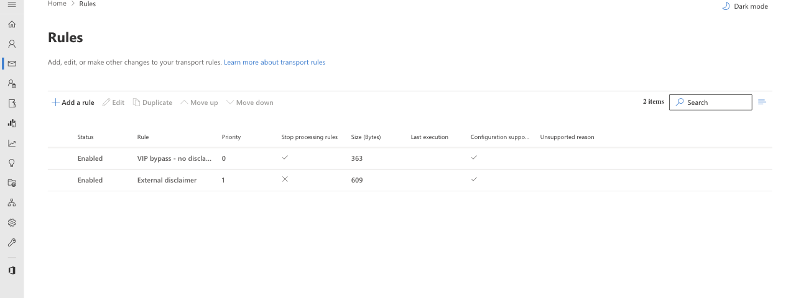

# TS-010: Disclaimer missing, mail flow rule order conflict

| | |
|---|---|
| **Level** | Expert |
| **Environment** | Microsoft 365 trial tenant, one external disclaimer rule and a pre-existing VIP bypass rule |
| **Access needed** | Exchange Administrator |
| **Time to resolve** | 20 minutes, once I stopped editing the disclaimer rule |

## Reproduction status

The two rules exist in the lab tenant exactly as described, with the priorities shown below and the stop flag set on the bypass rule. What is not in this tenant is a compliant external sender for the leadership path, so the missing disclaimer was never observed end to end, and the fix — clearing the stop flag — was not applied; the rules are still in their conflicting state for anyone who wants to walk the investigation. The marketing exception is the kind of second conflict I check for, not something this tenant has configured.

## What the user reported

Legal asked why outbound mail to external recipients no longer carried the confidentiality disclaimer. The disclaimer rule existed, it was enabled, the text was correct, and test messages from most users had it. Messages from the leadership team did not.

The rule had been edited four times in two weeks, each time re-testing with the same sender, which was the one sender it could never work for.

## Root cause

Transport rules run in priority order, lowest number first, and stop when a rule says so. Two rules were involved:

- **Priority 0, "VIP bypass - no disclaimer":** applied to messages from the leadership group, with **Stop processing more rules** set. It had been created to keep a few personal signatures intact.
- **Priority 1, "External disclaimer":** appended the confidentiality footer to mail from internal senders to external recipients.

Every message from a leader matched the first rule and stopped there, so the disclaimer rule never executed. The rule was never broken. It simply never ran for that audience.

The second, smaller conflict I look for next: an exception on the disclaimer rule, such as "sender is a member of Marketing", added during an earlier sign-off dispute. This tenant's rule has none, but where it exists and a leader is in that group, removing the stop flag would still leave them excluded.

## Where to look in the Exchange admin center

1. [admin.exchange.microsoft.com](https://admin.exchange.microsoft.com) → **Mail flow** → **Rules**. The list is ordered by priority; the number is shown next to each rule and can be edited inline.
2. Open the rule → **Stop processing more rules** is a checkbox under the rule's settings, visible only after you click **More options**.
3. **Mail flow** → **Message trace** → select the message → **Message events** shows which rule agents ran, which is how I proved the disclaimer rule was never reached rather than failing.
4. **Mail flow** → **Rules** → **Test** on the rule itself, if you want a dry run against a sample message before touching priority.

## Investigation

```powershell
Connect-ExchangeOnline -UserPrincipalName admin@contoso.onmicrosoft.com

# Priority order, stop flags and the condition that matters
Get-TransportRule |
    Format-Table Name, Priority, State, StopRuleProcessing, FromScope, SentToScope -AutoSize

# The two rules in detail
Get-TransportRule -Identity "VIP bypass - no disclaimer" |
    Format-List Name, Priority, State, StopRuleProcessing, From, ExceptIfFrom, Description
Get-TransportRule -Identity "External disclaimer" |
    Format-List Name, Priority, State, StopRuleProcessing, FromScope, SentToScope,
                ExceptIfSentToMemberOf, ApplyHtmlDisclaimerLocation,
                ApplyHtmlDisclaimerText, ApplyHtmlDisclaimerFallbackAction
```

The output made the ordering obvious in one screen: `StopRuleProcessing : True` on priority 0, with the disclaimer rule sitting below it at priority 1 and no exceptions of its own.

To confirm the path a real message took, I used a message trace rather than guessing:

```powershell
$trace = Get-MessageTrace -SenderAddress ceo.office@contoso.com `
    -StartDate (Get-Date).AddHours(-6) -EndDate (Get-Date) |
    Where-Object { $_.RecipientAddress -notlike "*contoso.com" }
$trace | Format-Table Received, RecipientAddress, Subject, Status -AutoSize

Get-MessageTraceDetail -MessageTraceId $trace[0].MessageTraceId -RecipientAddress $trace[0].RecipientAddress |
    Format-Table Date, Event, Action, Detail -AutoSize
```

The detail showed the transport rule agent running once, for the bypass rule, and no disclaimer event afterwards. That is the difference between "the disclaimer failed" and "the disclaimer never ran", and it changes the fix entirely. Headers on a received message can also help here: the organization-level `X-MS-Exchange-Organization-` headers record which rule agents touched the message, and comparing a working recipient's headers with the leader's showed one rule event where there should have been two.

## The fix, in order

1. **Decide the business rule before touching priority.** Legal wanted the disclaimer on every external message; the bypass existed to protect a couple of signature blocks. The correct answer was to keep the bypass but remove its stop flag, and to fix the signatures instead. Reordering first would have been treating the symptom.

2. **Remove the stop flag.** Either untick **Stop processing more rules** in the portal, or:

   ```powershell
   Set-TransportRule -Identity "VIP bypass - no disclaimer" -StopRuleProcessing $false
   ```

   This alone lets the disclaimer rule run for the leaders, in addition to the bypass rule's own action.

3. **Move the disclaimer rule to the top** if it must be unconditional and the bypass should still short-circuit later rules:

   ```powershell
   Set-TransportRule -Identity "External disclaimer" -Priority 0
   ```

   Exchange renumbers the rest automatically. Note that priority is a single ordered list across all rules, so moving one rule shifts others; check the whole list afterwards rather than only the two rules you touched.

4. **Fix the exception.** Remove the marketing group from the disclaimer's exception list if those users are supposed to have the footer, or make the exception deliberate and documented:

   ```powershell
   Set-TransportRule -Identity "External disclaimer" `
       -ExceptIfSentToMemberOf $null
   ```

   `-ExceptIfSentToMemberOf $null` clears the condition. If you only want to remove one group, pass the remaining groups explicitly instead.

5. **Recreate the disclaimer rule cleanly if it has accumulated edits.** A rule that has been patched five times is easier to replace than to reason about:

   ```powershell
   New-TransportRule -Name "External disclaimer" `
       -FromScope InOrganization -SentToScope NotInOrganization `
       -ApplyHtmlDisclaimerLocation Append `
       -ApplyHtmlDisclaimerText "<p><i>This message and any attachments are confidential...</i></p>" `
       -ApplyHtmlDisclaimerFallbackAction Wrap `
       -Priority 0
   ```

   `-ApplyHtmlDisclaimerFallbackAction Wrap` means the message is still delivered if the footer cannot be inserted as HTML, which is what legal actually wants: the disclaimer matters more than the formatting.

6. **Test from a real leader mailbox to a real external address.** Sending from your own admin account proves nothing about the VIP path, which is exactly how this survived four rounds of testing.

7. **Write the priority order down.** Put the rule list in the mail flow runbook with its priority numbers and stop flags, and update it whenever a rule is added. The next person to debug this should not have to reverse-engineer it.

## Verification and evidence

| Evidence | What it proves |
|---|---|
|  `TS-010-01-rule-list-priorities.png` | The ordering and the stop flag, before the change |
| *No capture — showing the missing disclaimer needs a real external message body, and no compliant sender was available from this tenant* | The symptom as the affected audience sees it |
| *No capture — the bypass rule was already at priority 0 above the disclaimer from the build, so no reorder was made in the portal* | The configuration change |
| *No capture — requires an external round trip to show the appended text* | The fix works end to end |
| *No capture — PowerShell output, and the captures here come from the browser* | Server-side confirmation of the final rule order |

Test matrix after the change: one message from a leader to Gmail (disclaimer present), one from a standard user to Gmail (disclaimer present), one internal-only message (no disclaimer, as designed), and one from the marketing group (disclaimer present once they were removed from the exception). All four behaved as specified, and the trace for each showed both rule agents where expected.

## Prevention notes

- Treat transport rule priority as configuration that needs a record, not an accident of creation order. A table in the runbook with name, priority, stop flag and owner prevents most of these tickets.
- Be careful with **Stop processing more rules**. It is a powerful and invisible switch; if you need it, name the rule so the behaviour is obvious ("Stop - VIP bypass").
- Avoid piling exceptions onto a rule that already has history. Replace it with a clean rule and delete the old one, so the next admin sees one condition set rather than five layers.
- Add rule changes to the change log. Every incident in this case started with an undocumented edit made for a good local reason.
- Test with a sender from the affected audience. Admin-account testing covers the generic path and misses exactly the rules that matter.

## Lesson learned

In mail flow rules, order is everything. A rule that is enabled, correct and never executed looks exactly like a broken rule from the outside, so check priority and stop flags before editing text. Document the priority of every rule, and test from the mailbox that actually has the problem.
